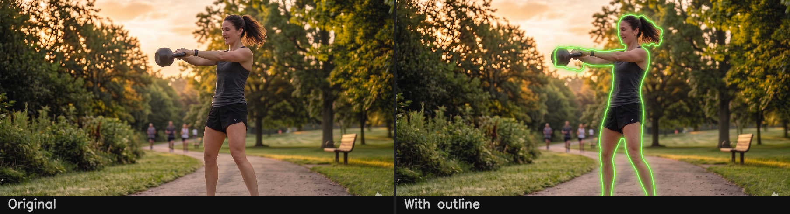

<div align="center">

# body-outline

**Draws a smooth neon glow outline around a person in any photo.**

Built from scratch as the overlay engine for [CameraCoach](https://github.com/abhis) — an app that lets you pick a reference photo and align your pose to it in real time.

</div>

---



---

## The Problem

CameraCoach needed one core feature: overlay a glowing silhouette of a reference pose over a live camera feed so users can see exactly where to position their body.

There was no open-source library or repo that did this cleanly. Most approaches gave you a bounding box, a rough blob, or a full segmentation mask — none of which are an outline. So this was built from scratch.

---

## How It Works

```
Input photo
    ↓
MediaPipe TFLite pose model
    → 39 body landmarks + coarse segmentation mask
    ↓
Skeleton mask (from landmarks) merged with segmentation mask
    ↓
GrabCut refinement  (sharpens edges against actual image pixels)
    ↓
Smoothed contour extraction
    ↓
Multi-layer neon glow drawn over the original photo
```

The segmentation mask from the model alone is too coarse — it misses thin limbs and bleeds at the edges. The landmark-based skeleton fills those gaps. Combining both, then sharpening with GrabCut, gives a much more accurate result than either approach on its own.

---

## Problems We Hit and How We Fixed Them

### Arms disappearing

GrabCut classified thin outstretched arms as background. Before GrabCut runs, we paint thick strokes along both arm chains into a "force foreground" mask. Those pixels are locked in and can't be removed.

### Held objects creating a distorted bump

When someone holds something in front of their body, the mask included it in a messy way. We added a blob detector that looks for dark, saturated pixels near the wrists, fits a clean ellipse over it, and adds it to the mask properly.

### Hair making the head edge spiky

Loose hair and ponytails create very noisy outline edges. We apply morphological smoothing only to the head region (bounded by ear and shoulder landmarks), using a connected component filter to make sure we only clean up actual head pixels.

### Face covered by the glow

The glow traces the full silhouette edge, which includes the face. After drawing the outline, a distance-transform-based alpha blend restores the original face pixels inside the head area. The glow stays on the edge — the face stays visible.

### Edges looking like a polygon

Raw OpenCV contours follow the pixel grid exactly. Each contour is resampled to evenly-spaced points along the perimeter, then smoothed with a wrapped 1D Gaussian filter. This produces organic, curved edges.

---

## Output Quality

Results vary based on the input photo.

The underlying model (`pose_landmark_full.tflite`) was trained by Google on a specific, relatively small set of images — mostly studio-style sports and activity photos with clear lighting and full body visibility. All the thresholds and pipeline parameters in this module were tuned to match that same type of image.

**Photos that match this style → clean, accurate results.**

Photos with unusual angles, heavy occlusion, motion blur, cluttered backgrounds, or poor lighting → inconsistent results. The segmentation mask starts out noisy and the pipeline can only partially compensate.

This is a known limitation. The plan is to fine-tune the segmentation stage on a dataset that better matches CameraCoach's real use cases, and add a confidence-based fallback for cases where the model isn't confident.

---

## Setup

Python 3.10+

```bash
pip install -r requirements.txt
```

**Model file:** Download `pose_landmark_full.tflite` and place it in the project root. It's not included in this repo due to size (6.1 MB).

> Download from: [MediaPipe Models — Pose Landmarker Full](https://storage.googleapis.com/mediapipe-models/pose_landmarker/pose_landmarker_full/float16/latest/pose_landmarker_full.task)

---

## Usage

Copy `.env.example` to `.env` and set your image path:

```bash
cp .env.example .env
```

```env
INPUT_IMAGE=your_photo.jpg
OUTPUT_IMAGE=your_photo_overlay.png
```

Then run:

```bash
python pose_outline.py
```

Or pass paths directly without touching `.env`:

```bash
python pose_outline.py your_photo.jpg output.png
```

**As a module:**

```python
from pose_outline import process

process("input.jpg", "output.png")
```

---

## Project Structure

```
body-outline/
├── pose_outline.py           # The full pipeline — one file, no extras
├── pose_landmark_full.tflite # Pose model (not tracked — download separately)
├── requirements.txt
├── .env                      # Your image paths — not committed
├── .env.example              # Template for .env
├── testImage.png             # Sample input
├── testImage_overlay.png     # Sample output
└── demo.png                  # Side-by-side comparison (README banner)
```

---

## Part of CameraCoach

CameraCoach is an app for getting the exact pose you want in a photo. You pick a reference image, and the app overlays a glowing silhouette of that pose over your live camera view so you can position your body to match it.

This module is the piece that generates that silhouette.

---

## License

MIT
